# FitTracker

A calm, all-in-one wellness app for iPhone: **workouts and training plans, sleep, medication and prayer**, in one place.

FitTracker has a soft "night sky" look. Every screen sits on a deep indigo background with slowly drifting glows, and each area of the app has its own pastel colours. The landscape art on the plan cards (hills, waves, peaks, a starry night with a crescent moon) is drawn in code with SwiftUI Canvas and Core Graphics, so the app ships no image files for it.

Everything you log stays on your iPhone and is encrypted while the phone is locked.

---

## Screens

### Home

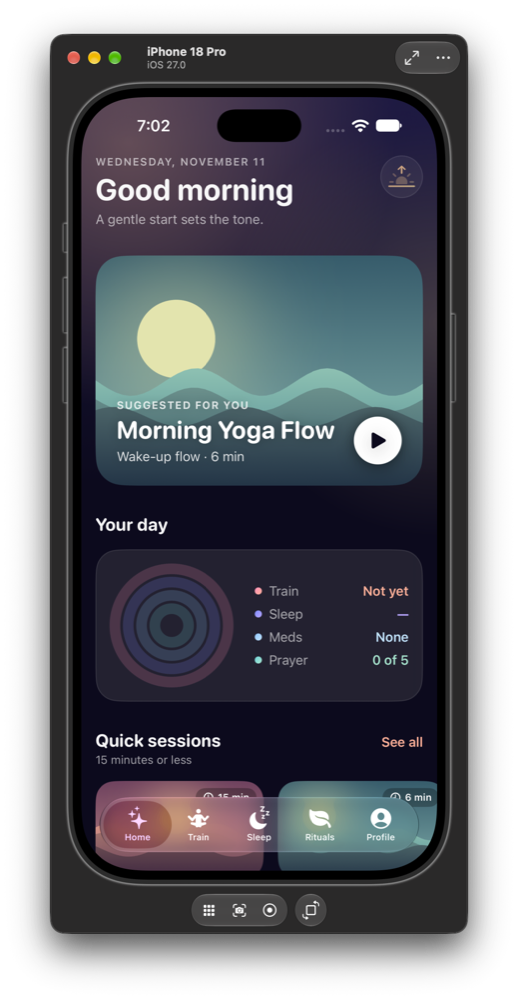

Your day at a glance.

- A greeting that changes with the time of day ("Good morning", "Good evening").
- **Suggested for you:** a session picked for right now. Morning yoga at the start of the day, strength in the afternoon, a wind-down stretch at night, or the next session of a plan you have already started.
- **Your day:** four rings for Train, Sleep, Meds and Prayer, each with a short status. Tap one to jump to that tab.
- **Quick sessions:** workouts of 15 minutes or less, as swipeable art cards.

<br clear="right">

### Training plans

<p>
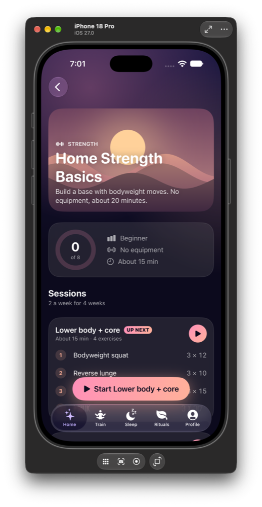
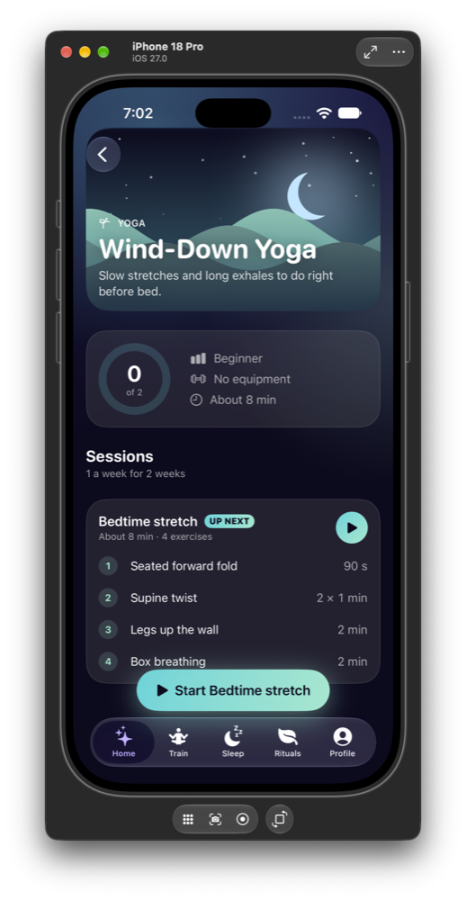
</p>

Seven ready-made plans across **strength, gym, yoga, HIIT, running and mobility**. Each plan has its own landscape art, a progress ring (sessions done out of the total), level, equipment and length.

- **Sessions** shows every workout in the plan with its exercises, sets, reps or hold times. The next one is marked **Up next**.
- A single **Start** button opens the guided session.
- The **Wind-Down Yoga** plan uses a night scene with stars and a moon, because it is made for bedtime.

### Guided session

<p>
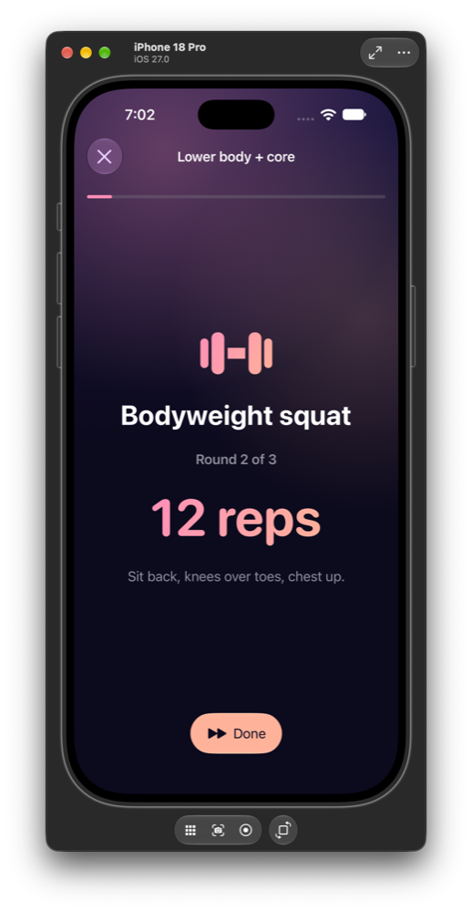
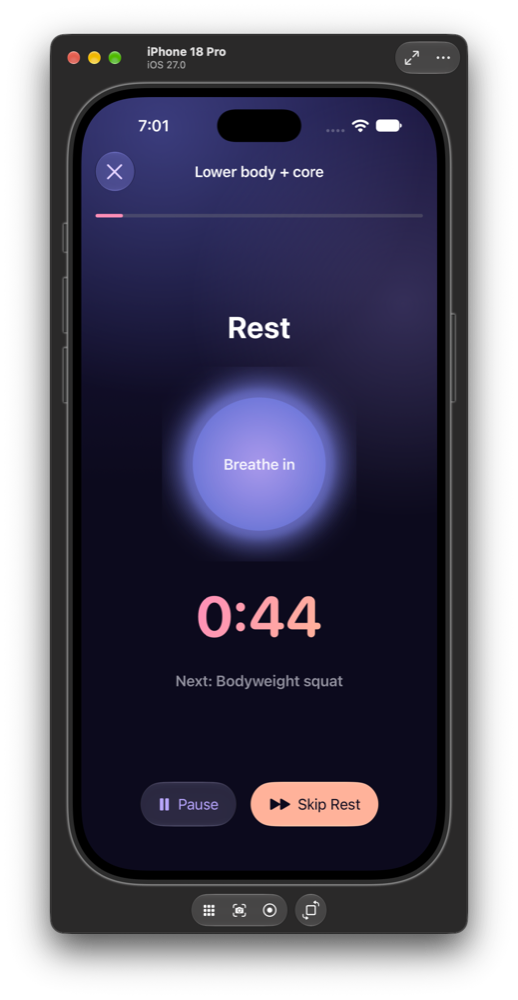
</p>

The session player walks you through the plan one step at a time.

- **Exercise:** the move, the round you are on, your target (for example **12 reps**) and a short form cue such as "Sit back, knees over toes, chest up."
- **Rest:** a countdown with a breathing orb that grows and shrinks ("Breathe in", "Breathe out") and shows what comes next. You can pause or skip the rest.
- The bar at the top shows how far through the session you are. Finishing a session plays a confetti burst and counts toward the plan.

### Free workout

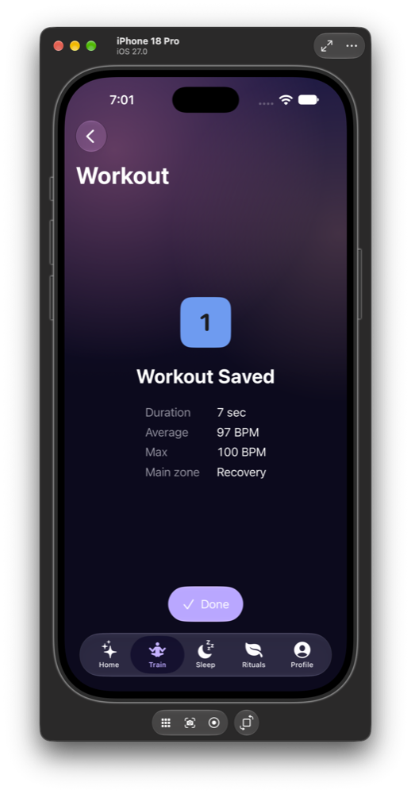

Start a workout with a heart-rate sensor and FitTracker tracks it live. When you finish, you see a summary:

- duration
- average and maximum heart rate
- the heart-rate zone you spent most time in

Saved workouts appear in **Profile → Workout history**.

<br clear="right">

### Sleep

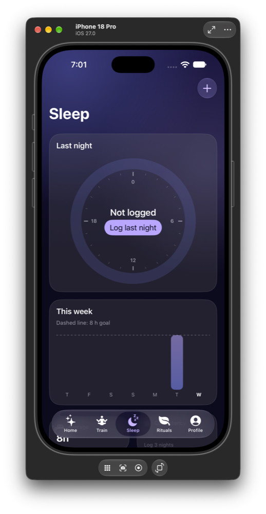

- **Last night:** a 24-hour sleep dial that draws an arc from bedtime to wake time. If you haven't logged it yet, a **Log last night** button sits in the middle.
- **This week:** a bar for each night against a dashed line for your 8-hour goal.
- Below that: your average sleep and a **consistency score** that shows how regular your bed and wake times are (it needs 3 nights).

<br clear="right">

### Rituals: Prayer

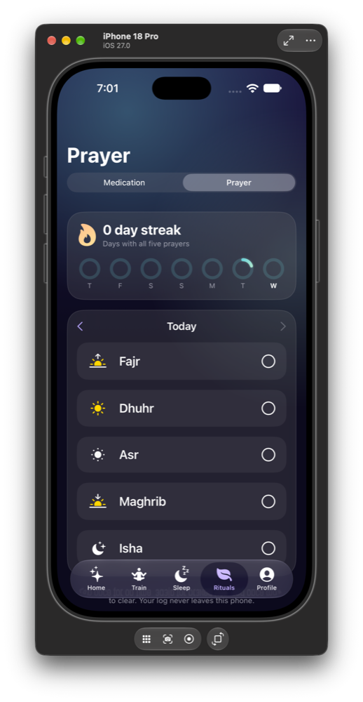

The Rituals tab holds **Medication** and **Prayer**, switched at the top.

- A **streak** counts days with all five prayers done, with a ring for each day of the week.
- Tap **Fajr, Dhuhr, Asr, Maghrib or Isha** to mark it on time. Tap again for late, and a third time to clear it.
- Use the arrows to go back and fill in earlier days.
- Completing all five plays a small celebration.

<br clear="right">

### Rituals: Medication

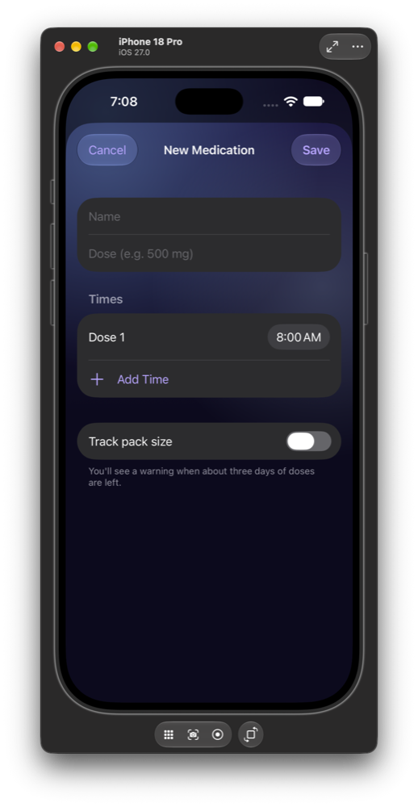

- Add a medication with its name, dose and one or more daily times.
- Turn on **Track pack size** to get a warning when about three days of doses are left.
- Each day you get a checklist of doses to mark as taken or skipped, plus your adherence for the week.
- Reminders arrive as local notifications that show only the medication name, never the dose.

<br clear="right">

### Profile and settings

<p>
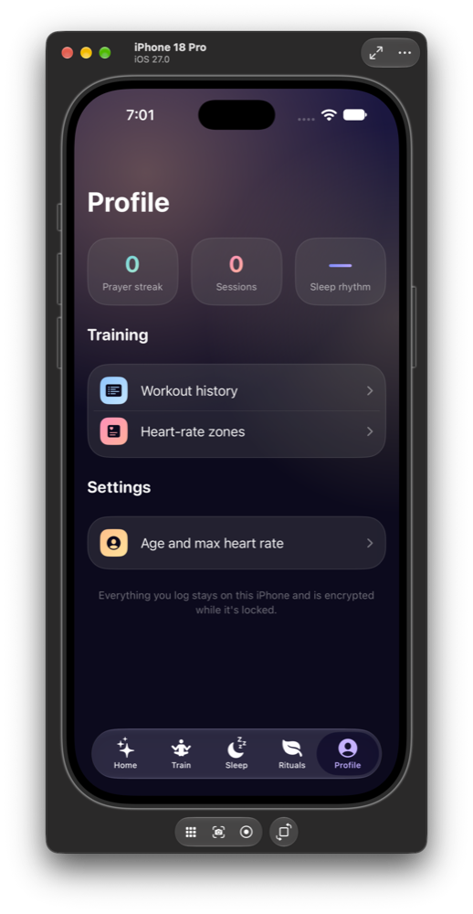
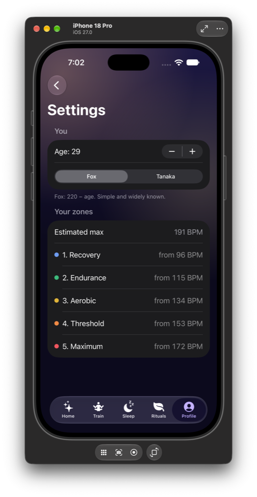
</p>

- **Profile** shows your prayer streak, completed sessions and sleep rhythm, with links to workout history, heart-rate zones and settings.
- **Settings:** set your age and pick a max heart rate formula (**Fox**: 220 − age, or **Tanaka**: 208 − 0.7 × age). Your five heart-rate zones update right away and are used everywhere in the app.

---

## How it's built

| Part | What it does |
|---|---|
| **FitTrackerKit** (Swift package) | All app logic, split into modules |
| `Domain` | Pure Swift rules: heart-rate zones, plans and progress, the session player, sleep stats, medication schedules, prayer streaks |
| `Features` | One `@Observable` view model and its screens per area (Plans, Sleep, Medication, Prayer, Workout, History, Settings) |
| `DesignSystem` | Palette, frosted cards, the night background, and the Canvas / Core Graphics art: landscapes, rings, sleep dial, breathing orb, confetti |
| `Repositories` | Saving to disk (atomic JSON files with full file protection) and medication notifications |
| **FitTracker** (app) | The tab layout and the `AppContainer` that wires everything together |
| **FitTrackerAPI** + **Server** | A shared API contract and a Vapor server for syncing later |

- Swift 6 with strict concurrency, SwiftUI, iOS 27
- Changes show on screen instantly and roll back if saving fails
- Animations respect **Reduce Motion**

## Tests

The package has **142 tests** written with Swift Testing. They cover the domain rules, the view models (including fast repeated taps and save failures) and the file storage.

```bash
cd FitTrackerKit && swift test
```

## Running the app

1. Open `FitTracker.xcodeproj` in Xcode.
2. Pick an iPhone simulator.
3. Press **Run**.
